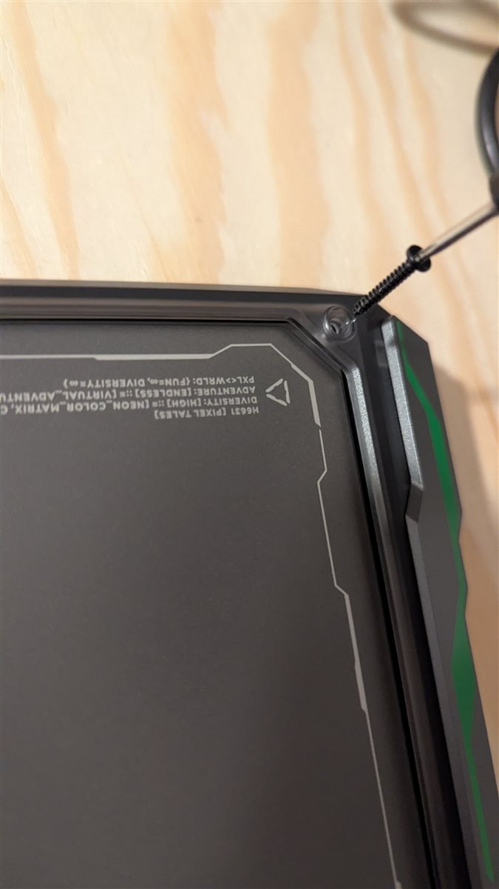
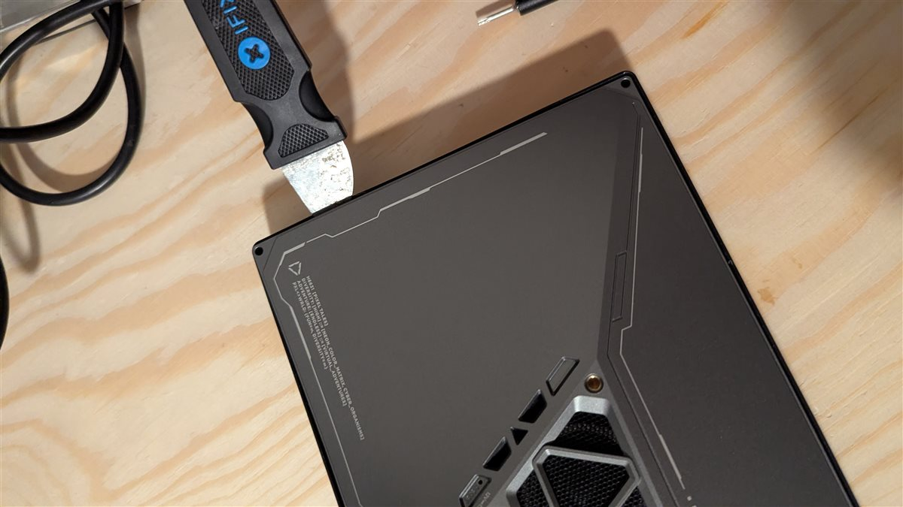
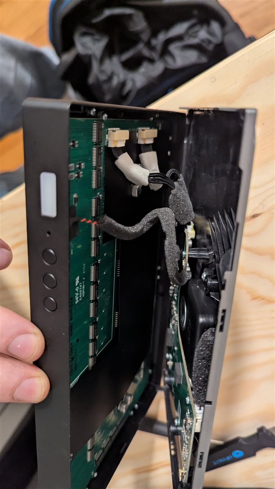
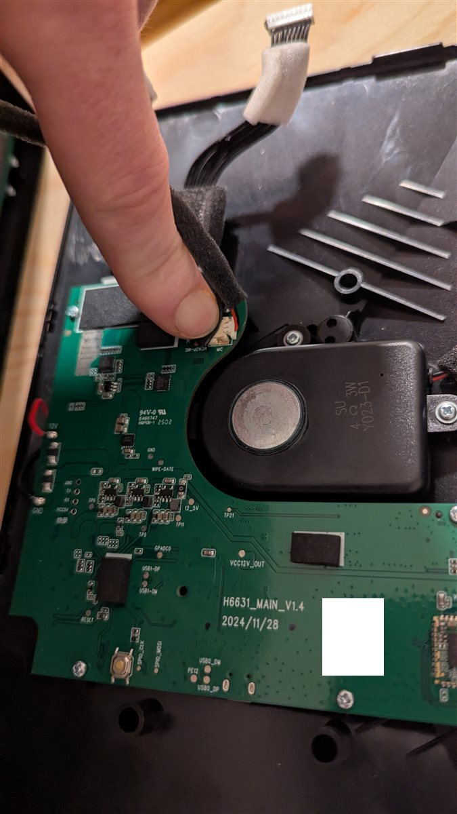
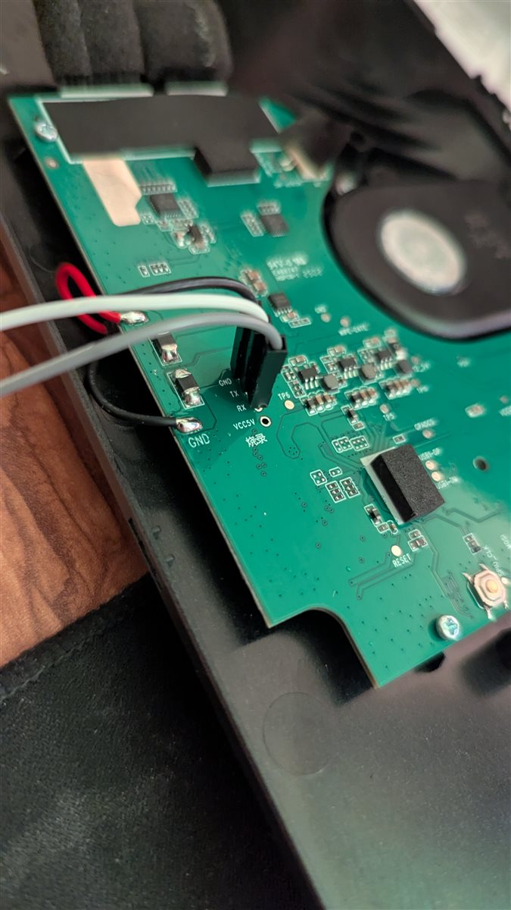
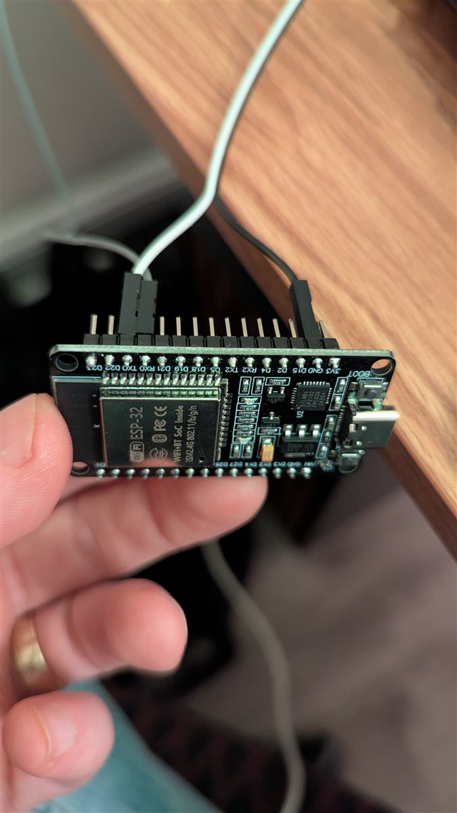
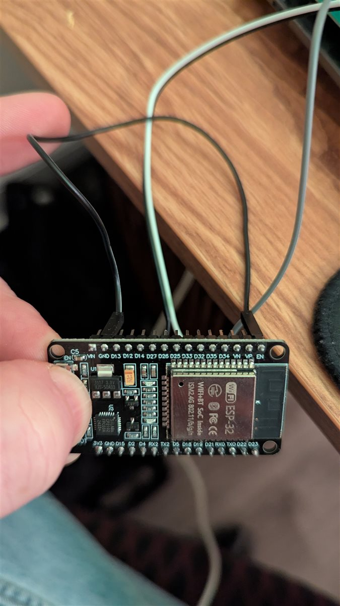

# pixeld-h6631

**Unofficial custom firmware for the Govee H6631 Gaming Pixel Light** (52×32 RGB pixel display).
It replaces Govee's apps with **pixeld**, a small local-only display daemon:
- no cloud connection;
- Home Assistant over MQTT through [pixel2mqtt](https://github.com/SamWiIIiams/pixel2mqtt), the recommended
  setup: one bridge for all your displays, plus a web editor for animations and icons. (For a standalone
  install, the display can also connect straight to your MQTT broker.)
- a LAN API for uploads, previews and live frames.

> Not affiliated with or endorsed by Govee. Installing this means opening the device, using its serial console
> and rewriting its flash. You can brick your unit; you do this at your own risk. The stock firmware stays in
> the other A/B slot, so a rollback is possible (see [docs/INSTALL.md](docs/INSTALL.md)).

## What it does
- **Display modes:**
  - clock: digital, analog, or a clock drawn over one of the animated scenes;
  - scrolling text;
  - images and animations;
  - generative effects: Snake, Bouncing Balls, Match 3, Flow, Fireworks, Starfield, Rain and more;
  - music visualiser, using the built-in microphone;
  - info screens: weather, room climate, stocks, NFL/NBA scores;
  - countdown and stopwatch;
  - a playlist that rotates through all of the above.
- **Home Assistant:** MQTT discovery for a light, mode/animation/effect selects, text, notify, chime volume,
  buttons, countdown/stopwatch, and device triggers for the four physical buttons.
- **Notifications** with a colour, sound and/or animation, and a **doorbell chime** through the speaker
  (with no amplifier pops).
- **Bluetooth LE sensor bridge (`bled`):** passive scanning for Govee, BTHome and ATC/pvvx thermometers,
  published to MQTT.
- **Wi-Fi setup hotspot:** if the display can't reach its network, or you hold the Mode button for 5 s,
  it starts a hotspot with a setup page.
- **LAN API** (HTTP port 80, token pairing via a code on the panel) and raw UDP frames on port 7777.
  See [docs/API.md](docs/API.md).

**No Govee artwork is included.** The display's own firmware still contains Govee's stock animations and icons
in `/usr/res`. [pixel2mqtt](https://github.com/SamWiIIiams/pixel2mqtt) converts them on your device with one
click, using the scene renderer in `tools/graffiti.py`.

## Installation
A PC program, `installer/pixeld_install.py`, does the whole install over the display's serial console. The only
manual parts are opening the case and connecting three wires. (Doing it by hand instead:
[docs/INSTALL.md](docs/INSTALL.md).)

**You need:**
- a **T6H** Torx screwdriver and a plastic pry tool;
- an **ESP32 dev board** as the USB-serial adapter (most ESP32 boards work) and four jumper wires. Any 3.3 V
  serial adapter that supports 1 500 000 baud also works: FT232R, CP2102, CH340 or CH343 based, or a Raspberry
  Pi's GPIO UART;
- a PC with **Python 3.8+** (Windows, macOS or Linux; nothing else to install);
- the display **set up in the Govee Home app and on your Wi-Fi**. The installer uses that connection, and the
  custom firmware keeps the same Wi-Fi settings;
- about 30 minutes.

### Before you start: load the Govee scenes you want
The display only ships with part of Govee's library: about 60 built-in animations. The rest (150+ scenes and
everything in the app's community Share Space) is sent from the Govee Home app when you pick it. After the
install, the Govee app can't reach the display any more. So while it still runs the stock firmware:
- open each scene or DIY you'd like to keep in the Govee Home app and **apply it to the display** once (saving
  it in the app isn't enough: it has to be sent to the panel);
- skip any firmware update the app offers.

Missed one? Roll back to stock (`--rollback`), load it in the app, and run the installer again.

Everything you apply is stored on the display, and the install leaves it there. pixel2mqtt's **Import built-in
animations & icons** button converts these along with the built-ins (they appear as "App <code>", since the app
keeps no titles on the device; rename them as you like). Govee's and other people's artwork is for personal use
on your own display only.

### 1. Get the installer
Download `pixeld-installer-<version>.zip` from the
[latest release](https://github.com/SamWiIIiams/pixeld-h6631/releases/latest) and unzip it. It contains the
installer, pixeld and bled built for the display, and the firmware scripts. No Govee software or artwork is
included.

(From a git checkout instead, build the programs first with `sh build.sh`; see [Building](#building).)

### 2. Open the case
1. Unplug the power.
2. Remove the **four T6H Torx screws**, one in each corner, and take off the bezel.
3. Carefully pry the case in half from the back, starting at a corner. Go slowly: the halves are joined by
   **two ribbon cables and a small two-wire harness**. Disconnect them before you pull the halves apart.
4. Leave them disconnected until the install is done. The controller board boots and flashes without the panel.

 
 

### 3. Connect the serial console
The controller board (`H6631_MAIN_V1.4`) has four pads labelled `GND TX RX VCC5V`, next to the 12 V input
(left edge of the board in the photo above). Male jumper pins pushed into the pad holes hold well enough; no
soldering needed.

| Display pad | ESP32 board |
|---|---|
| GND | GND |
| TX | TX0 |
| RX | RX0 |
| VCC5V | not connected |
| | EN to GND (a jumper on the ESP32) |

- **EN to GND** holds the ESP32 in reset, so its USB-serial chip works as a plain adapter. That's also why TX goes
  to TX0 and RX to RX0 (not crossed). With any other adapter, cross them: TX→RX, RX→TX.
- **Don't connect `VCC5V`**: the display powers itself, and its pins are 3.3 V.
- Plug the ESP32 into the PC and the display into its power.

  

### 4. Run the installer
```sh
python installer/pixeld_install.py     # run it from the unzipped folder
```
It asks for:
- **the serial port**, if there's more than one;
- **your time zone**, with a suggestion from your PC's;
- **how Home Assistant should connect**: through [pixel2mqtt](https://github.com/SamWiIIiams/pixel2mqtt)
  (recommended), or, for a standalone install without pixel2mqtt, directly to your MQTT broker (address, user,
  password).

It shows a summary and waits for your OK. Then it runs these steps, about 5 minutes in all:
1. **Backs up the whole flash** to a `h6631-backup-<date>` folder on the PC and checks every copy. The backup holds
   your Wi-Fi credentials and device keys: keep it private.
2. Sets `bootdelay=3`, so you can always reach the bootloader over serial.
3. **Builds the custom firmware from your own device's stock firmware.** Nothing of Govee's is downloaded or
   included in this repo.
4. **Writes it to the unused A/B slot.** The stock firmware in the other slot is never touched.
5. Installs pixeld, your SSH key (`~/.ssh/id_ed25519.pub` or similar; it offers to create one) and the settings.
6. Switches to the new slot, reboots, and checks that it came up.

### 5. Close it up
Unplug the power, remove the serial wires, and reconnect the two ribbon cables and the two-wire harness. The two
halves then just snap back together. The screws only hold the bezel; putting it back on is optional (it looks good
without it too). When it powers up, the panel shows the clock.
- `ssh root@<display-ip>` logs you in with your key; updates from here on go over SSH.
- If the display can't join your Wi-Fi, it opens a `govee-pixel-setup` hotspot and shows its password on the
  panel. You can also start it any time by holding the Mode button for 5 s.

### 6. Home Assistant
**With pixel2mqtt (recommended):** install [pixel2mqtt](https://github.com/SamWiIIiams/pixel2mqtt) (as a Docker
container, or as an app on Home Assistant OS via [pixel2mqtt-addon](https://github.com/SamWiIIiams/pixel2mqtt-addon)), adopt the
display in its web UI (a pairing code appears on the panel), then click **Import built-in animations & icons** to
convert the stock artwork that's already on your device. The display then appears in Home Assistant, and the web
editor can upload GIFs, draw icons and build layered animations.

**Standalone (direct MQTT):** the display shows up in Home Assistant by itself through MQTT discovery. You can
add pixel2mqtt later: adopting the display hands MQTT over to it.

### Going back to stock
Your stock firmware is still in the other slot. With the serial console connected:
```sh
python installer/pixeld_install.py --rollback
```
Your pixeld settings stay in `/data/custom`, so you can switch back the same way.

## Layout
| Path | |
|---|---|
| `src/pixeld.c` (+ `features.c`, `api.c`) | Display daemon (single-threaded, 30 fps, unity build) |
| `src/bled.c` | BLE thermometer bridge |
| `src/pixeltest.c` | Panel test tool |
| `installer/` | The PC installer: serial console, backup, SquashFS builder, flashing |
| `firmware/` | Rootfs build script, init overlay, and the persistent `/data/custom` scripts (autostart, Wi-Fi manager, chime) |
| `tools/` | PC tools: animation/icon converters, Govee scene renderer, UDP/MQTT test clients |
| `scripts/` | Windows helpers for the serial console and for writing the Wi-Fi/MQTT configs |
| `ha/` | Example Home Assistant package (weather, climate, stocks, scores, notifications) |
| `docs/` | Hardware notes, install guide, API, file formats |

## Building
The device runs Linux 5.4 with glibc 2.29 (armhf, Cortex-A7). [Zig](https://ziglang.org/) 0.13 cross-compiles
for that exact glibc:
```sh
ZIG=~/zig/zig sh build.sh
```
Then copy `build/pixeld` to `/data/custom/apps/pixeld` on the device and restart it (`killall pixeld`;
the autostart loop restarts it).

Two Zig/glibc-2.29 traps:
- `stat()` always fails; use `opendir`, or `open` + `lseek`.
- Absolute times overflow 32-bit `int`/`long` (`(int)(now * 2)`); use `fmod` or relative times.

## Status
Runs daily on one H6631 (firmware 1.00.91, board `H6631_MAIN_V1.4`). Other hardware revisions are untested.

## Licence
MIT (see [LICENSE](LICENSE)). Govee artwork is not covered and is not included.
